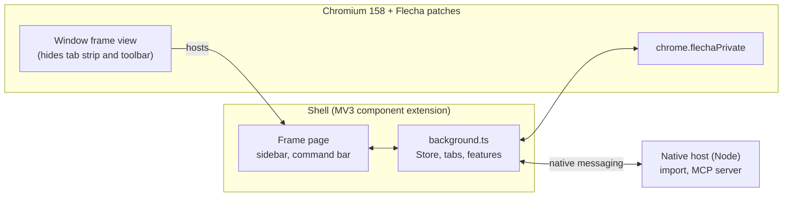

# Flecha

An Arc-style browser for developers, built on a Chromium fork. Arc's interface ideas are rebuilt from scratch; no Arc code is used.

<p align="center"></p>

## Why

Arc's vertical sidebar, Spaces and Peek are hard to give up, and Arc is no longer where the work is happening. Flecha is a replacement that keeps those ideas and adds tools for the people who build websites.

It is a Chromium 158 fork rather than an Electron app because Google blocks sign-in in Electron. Flecha is real Chromium, so Google sign-in, Chrome Web Store extensions and the rest of the web platform work as they do in Chrome. Flecha started as an Electron app; that version is gone from the repo (it's in the git history before the move to `chromium/`).

## Features

**Sidebar and tabs**
- A vertical sidebar with favourites, pinned tabs (with folders) and Today tabs, per Space
- Drag tabs between favourites, pinned, folders and Today
- Today tabs archive themselves after 12 hours by default (1 day, 7 days, 30 days or never in Settings); the archive is searchable
- Closing a pinned tab or favourite only unloads it and sends it back to its pinned URL
- Per-site favicons, tab muting, duplicate, copy link or Markdown link, copy screenshot
- On launch, the window comes back where it was

**Spaces**
- Spaces with their own colour and emoji; in dark mode the colour becomes a deep tint of the same hue
- Right-click a Space, then Separate Cookies and Logins, to be signed in as different users side by side (a persistent storage partition per Space)
- Switch with ⌃1 to ⌃9, or next and previous Space with ⌥⌘← and ⌥⌘→

**Command bar**

<p align="center"></p>

- ⌘T for a new tab, ⌘L for the current one; it searches open tabs, the archive and history
- Developer shortcuts: `gh owner/repo`, `gh 123` (in the current tab's repo), `npm react`, `mdn grid`, `caniuse :has`, `so ...`, and `env`
- Paste a JWT or a Unix timestamp to decode it in place
- Type `boost` to open the Boosts page

**Peek, split view and Flechinha**
- Peek: links that open a new tab from a pinned tab or favourite show in a floating preview; any link's right-click menu offers it too. Esc or a click outside closes it, Open turns it into a tab
- Split view: right-click a tab, Open in Split View, or ⌃⇧= to split with a new tab (⌃⇧- exits)
- Flechinha: a small standalone window for a quick page (⌥⌘N), which can be sent back into the main window

<p align="center"></p>

<p align="center"></p>

**Boosts**
- Per-site TypeScript and CSS (`github.com.ts`, `github.com.css`, `all.css`), kept in Flecha and edited on the Boosts page. CSS applies live; scripts reload the page. ⌥⌘B edits the current site's boost

**For developers**
- Console error badge: local tabs show how many console errors they have; clicking it opens the Console
- Responsive view (⌥⌘M): the page as a phone (393px, touch, mobile user agent) next to desktop
- Running locally: dev servers listening on this Mac show up in the sidebar, named after their project folder
- Environments: group a project's origins (local, staging, production) in Settings; ⌥⌘E moves the page to the next one with the same path, and the address bar shows a LOCAL, STAGING or PROD badge
- Chromium's DevTools (⌥⌘I), View source (⌥⌘U), zoom and Find in page
- Coding agents (MCP): Settings, Coding agents turns on a local MCP server (127.0.0.1, token required) so Claude Code, Cursor and others can list tabs, read pages and console logs, take screenshots, click, type and run JavaScript. It needs the native host (see Install)

**Privacy and the rest of the browser**

<p align="center"></p>

- Built-in ad and tracker blocking (EasyList and EasyPrivacy as declarativeNetRequest rules, plus element hiding), toggled in Settings
- Incognito windows get the same Flecha frame, with one in-memory Space that is forgotten when the last incognito window closes
- Import bookmarks and history from other browsers and from Arc's sidebar (needs the native host)
- Chrome extensions: install from the Chrome Web Store; their buttons appear under the address bar
- Light, dark or system theme; Flecha's shortcuts can be re-recorded in Settings (except a few Chromium keeps, like ⌘T and ⌘W) (⌘/ lists them)
- Settings (⌘,): search engine (Google, DuckDuckGo, Bing, Brave, Kagi, Ecosia), ad blocking, default browser, Peek behaviour, shortcuts, environments

Not there yet in the Chromium build: choosing the downloads folder from Settings, and the welcome tour.

## Install

1. Download the latest `Flecha-<version>.dmg` from [Releases](https://github.com/lucianodiisouza/flecha-browser/releases). Releases are signed with a Developer ID and notarized by Apple. They are **Apple Silicon (arm64) only** for now; Intel is planned.
2. Open the dmg and drag Flecha onto Applications.

<p align="center"></p>

3. Optional, but needed for importing from other browsers and Arc, and for the coding-agent MCP server:

```bash
git clone https://github.com/lucianodiisouza/flecha-browser.git && cd flecha-browser
chromium/scripts/install-native-host.sh --app /Applications/Flecha.app
```

Browsers can't read other browsers' files or open a local port, so Flecha ships a small native messaging host (a bundled Node, in the app). The script registers it with Chromium for Flecha's profile folder. It allows only Flecha's own shell extension to talk to it. Run it again if you move the app.

### Linux (Arch and Omarchy)

There are no prebuilt Linux packages yet. `flecha-git` builds Flecha from source, from Chromium's release tarball (several hours, about 30 GB of disk and 16 GB of memory):

```bash
git clone https://github.com/thieso2/flecha-browser.git
cd flecha-browser/chromium/linux/aur && makepkg -si     # or: yay -S flecha-git, once it is on the AUR
```

If you already build Flecha with the scripts (see [Build from source on Linux](#linux)), install the package `build-release.sh` makes instead:

```bash
cd "$CHROMIUM_SRC/out/Release/flecha-release" && makepkg -si
```

The package installs Flecha in `/opt/flecha`, `flecha` on your `PATH`, a desktop entry, and the native host for every user (it runs with the system's Node, so install `nodejs` for importing and the MCP server). Flecha keeps its profile in `~/.config/flecha-browser`, apart from Chromium's.

On Omarchy:

- Make Flecha the default browser with `xdg-settings set default-web-browser flecha.desktop`. Omarchy's browser key and links from other apps then open Flecha; links from other apps open in a Flechinha while Flecha's window is up, as on macOS.
- Flecha asks Hyprland for server-side decorations, so the window has no title bar of Chromium's and Hyprland's borders and rounding apply.
- Flags go in `~/.config/flecha-flags.conf`, one or more per line, like `chromium-flags.conf`. Omarchy's Chromium flags suit Flecha too, except `--load-extension` (Omarchy's extensions are for Chromium): `grep -v load-extension ~/.config/chromium-flags.conf > ~/.config/flecha-flags.conf`. `--password-store=gnome-libsecret` keeps saved passwords in the keyring.
- On a compositor without server-side decorations (GNOME's Mutter), Chromium draws its own title bar above Flecha's frame. Under Xwayland the window class is `Flecha`; on Wayland the app_id is `flecha`.
- To tile Flecha like Omarchy's other Chromium browsers, add `o.window("flecha", { tag = "+chromium-based-browser" })` to `~/.config/hypr/hyprland.lua`.
- Shortcuts follow Linux conventions: Ctrl where macOS uses ⌘, Alt+1 to Alt+9 for Spaces, and Alt+Left and Alt+Right for back and forward. Where Ctrl would take one of Chromium's own keys, Flecha's moves: New Space is Alt+Shift+N, split view Ctrl+Alt+= and Ctrl+Alt+-, Copy link Ctrl+Shift+L. Super is left to Hyprland. Ctrl+/ lists them all.

## Build from source

You need:

- macOS on Apple Silicon, with Xcode (and its command line tools)
- [depot_tools](https://commondatastorage.googleapis.com/chrome-infra-docs/flat/depot_tools/docs/html/depot_tools_tutorial.html) on your `PATH`
- a Chromium checkout at the version Flecha targets (158), with plenty of disk (100 GB or more) and several hours for a first build
- Node 22.5 or newer (the native host uses `node:sqlite`) and `npm ci` at the repo root

Fetching the Chromium checkout isn't scripted here; follow Chromium's [macOS build instructions](https://chromium.googlesource.com/chromium/src/+/main/docs/mac_build_instructions.md). Build on an APFS volume: `env.sh` expects the checkout on APFS because siso treats every output as stale on HFS+ (one-second file times) and rebuilds everything.

`chromium/scripts/env.sh` says where things live, and every script reads it. Override with `CHROMIUM_SRC` (the checkout's `src`), `DEPOT_TOOLS`, `FLECHA_DISK`, `FLECHA_VOLUME` and `FLECHA_PROFILE` (the dev profile). Its defaults assume a disk image that it mounts for you, so set these for your own layout.

### The dev loop

```bash
npm ci
chromium/scripts/build.sh              # apply.sh (branding and patches), then autoninja -C out/Dev chrome
chromium/scripts/run.sh                # launch out/Dev/Flecha.app with its own profile
node chromium/shell/build.mjs          # shell-only change: rebuild, then relaunch run.sh
npm run typecheck
```

`apply.sh` is safe to run again: it first resets every file it touches. The dev build is a component build, so a change relinks one small library. `run.sh` loads the shell from `chromium/shell/dist` through `--flecha-shell-dir`, so UI work needs no Chromium build at all (`npm run shell:watch` rebuilds on save).

### Release

```bash
export FLECHA_SIGN_IDENTITY="Developer ID Application: Your Name (TEAMID)"
export FLECHA_NOTARY_PROFILE=flecha-notary   # made once with: xcrun notarytool store-credentials
chromium/scripts/build-release.sh --dmg
```

`build-release.sh` builds the shell, applies the patches, stages the shell into the checkout, writes `out/Release/args.gn` from `chromium/build/release.gn`, builds (3 to 6 hours, resumable) and calls `package-release.sh`. That copies the app, adds the native host with its Node, signs everything innermost first (hardened runtime, timestamp and Chromium's entitlements when `FLECHA_SIGN_IDENTITY` is set; ad hoc otherwise), makes the dmg with an installer window, and with `FLECHA_NOTARY_PROFILE` notarizes it and staples the ticket. Releases use `target_cpu = "arm64"` and no proprietary codecs (H.264 and AAC), which need patent licences.

### Linux

The same scripts build on Linux (x86_64). You need:

- an x86_64 Linux machine; Chromium's `install-build-deps.py` covers Debian, Ubuntu and Fedora, and on Arch you install the equivalents by hand (the build compiles against Chromium's own sysroot)
- depot_tools on your `PATH`, a Chromium checkout at the version Flecha targets (158.0.8121.1 is the one the patches are checked against), about 100 GB of disk and several hours for a first build
- Node 22.5 or newer and `npm ci` at the repo root

Follow Chromium's [Linux build instructions](https://chromium.googlesource.com/chromium/src/+/main/docs/linux/build_instructions.md) to fetch the checkout and its build dependencies. `env.sh` expects it at `~/flecha/chromium/src` with depot_tools at `~/flecha/depot_tools`; set `CHROMIUM_SRC`, `DEPOT_TOOLS` or `FLECHA_DISK` for another layout.

```bash
chromium/scripts/build.sh              # first run writes out/Dev/args.gn from chromium/build/linux-dev.gn
chromium/scripts/run.sh                # launch out/Dev/chrome with its own profile
chromium/scripts/build-release.sh      # out/Release from chromium/build/linux-release.gn, then package-release-linux.sh
```

`package-release-linux.sh` packs `out/Release` into `flecha-<version>-linux-x64.tar.xz` (Chromium's runtime files, the shell, the launcher, desktop entry, icons and the native host) and writes a `PKGBUILD` beside it. The Linux patches are numbered from 0060: the profile and native-host folders, compositor decorations, links from other apps, the shell in release builds, and the `flecha` desktop entry and window class.

## Repo layout

```
chromium/
  patches/       the native changes to Chromium, as numbered unified diffs
  branding/      app icon, logo, BRANDING, the dmg background
  build/         dev.gn and release.gn (the GN args), linux-dev.gn and linux-release.gn
  linux/         the Linux launcher, desktop entry and PKGBUILD; aur/ is flecha-git
  scripts/       apply, build, run, env, build-release, package-release,
                 package-release-linux, install-native-host, dmg-layout.py
  shell/         the MV3 component extension that draws the window
    background.ts   service worker: the Store, tabs, windows
    features/       ad blocking, boosts, console errors, local servers, responsive view
    ui/             sidebar, command bar, settings and Flechinha pages
    lib/            URLs, shortcuts, environments, settings rules, tab manager
  shared/        types and the sidebar model, used by the shell and the host
  native-host/   the native messaging host (Node)
```

## Architecture in brief

Flecha is Chromium plus two layers: a small set of patches, and an extension that draws the browser.



- **Patches** (`chromium/patches/`) change what only Chromium can: hide the tab strip and toolbar, draw Flecha's own window frame and traffic lights, round the page area, add Peek, Flechinha windows, split ratio, a storage partition per Space, and so on.
- **The shell** is a Manifest V3 extension loaded as a component extension, so it can't be removed or turned off. Its service worker (`background.ts`) owns the Store and the tabs; everything the user sees is shell HTML and TypeScript.
- **The frame page** is a shell page that Chromium's frame view hosts around the web contents. It draws the sidebar and command bar, and its drag regions move the window.
- **`chrome.flechaPrivate`** (`shell/flechaPrivate.d.ts`) is the private extension API the patches add, for what the standard APIs lack: frame state, shortcuts, theme, split ratio, Peek, Flechinha, partitions, DevTools, the find bar and default-browser. It is available to the shell only.
- **The native host** does what an extension can't: read other browsers' bookmarks and history, and serve MCP to coding agents on 127.0.0.1.

## Status and roadmap

Flecha is early software, used daily by its author. Next:

- Intel (x86_64) builds
- Auto-update with Sparkle (in progress)
- Resizable split divider and 3 to 4 pane splits
- Choosing the downloads folder and the welcome tour in the Chromium build

## Contributing

Bug reports and patches are welcome; see [CONTRIBUTING.md](CONTRIBUTING.md) for setup, how patches work, and the commit style.

## License

Flecha's own code is released under the [MIT license](LICENSE). Flecha is built on [Chromium](https://www.chromium.org/); Chromium and its third-party components keep their own BSD-style and other licenses, and those notices apply to the browser builds. Flecha is not affiliated with or endorsed by Google, Arc or The Browser Company.
